# Biomta - Docker 실습 및 환경 검증 프로젝트

본 문서는 Windows의 Git Bash와 Docker Desktop 환경에서 수행한 기본 명령어, Docker 이미지·컨테이너, 웹 서버 실행 및 데이터 마운트 실습을 정리한 과제 보고서입니다.

> **실행 결과 작성 원칙:** 실제 실행을 확인한 결과와 재현을 위한 명령 예시를 구분했습니다. 예시 출력은 실제 측정 결과로 오해하지 않도록 표시했습니다.

---

## 1. 프로젝트 디렉토리 구성

주요 파일과 디렉토리의 역할은 다음과 같습니다.

| 항목 | 용도 |
|---|---|
| `README.md` | 실습 과정 및 결과 보고서 |
| `Dockerfile` | 사용자 정의 Docker 이미지 빌드 설정 |
| `script.sh` | 셸 스크립트 실습 파일 |
| `test.txt` | 파일 생성 및 관리 실습 파일 |
| `src/` | 소스 코드 및 관련 리소스 |
| `backup/` | 백업 파일 보관용 디렉토리 |

### 디렉토리 및 파일 생성

```bash
mkdir -p src backup
touch README.md test.txt
pwd
ls -la
```

### 파일 이동 및 삭제 실습

```bash
mv test.txt backup/
ls -la backup/
rm -rf backup/
```

위 삭제 명령은 `backup/` 디렉토리와 그 안의 파일을 삭제합니다. 실제 과제 제출본에서는 필요한 백업 파일이 남아 있는지 먼저 확인해야 합니다.

---

### 프로젝트 디렉토리 구성 캡처

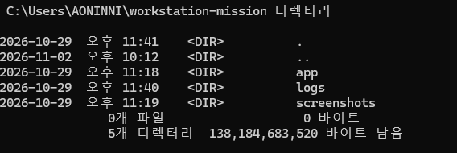

---

## 2. 파일 권한 설정 실습

`chmod` 명령으로 셸 스크립트에 실행 권한을 부여합니다.

```bash
chmod 755 script.sh
ls -l script.sh
```

기존 저장소에 기록된 권한 확인 결과:

```text
-rwxr-xr-x 1 AONINNI 197121 13 Nov  2 21:19 script.sh
```

### 파일 권한 확인 캡처

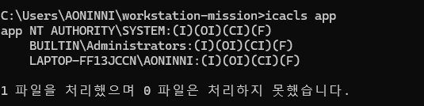

### 권한 숫자의 의미

- `r`(읽기) = 4
- `w`(쓰기) = 2
- `x`(실행) = 1
- `755` = 소유자 `rwx`, 그룹 `r-x`, 기타 사용자 `r-x`

---

## 3. Docker 설치 및 실행 상태 확인

### Docker 버전

실습 환경에서 확인한 Docker Client/Server 버전은 **29.9.2**입니다.

```bash
docker --version
docker info
```

기존에 기록한 `docker info` 결과 중 확인 가능한 항목:

```text
Client:
 Version: 29.9.2
 Context: desktop-linux

Server:
 Server Version: 29.9.2
 Operating System: Docker Desktop
```

### Docker 정상 동작 확인

```bash
docker run hello-world
```

기존 실습 기록에는 다음 성공 메시지가 포함되어 있습니다.

```text
Hello from Docker!
This message shows that your installation appears to be working correctly.
```

### 컨테이너 및 이미지 목록 확인

```bash
docker ps -a
docker images
```

기존 기록에는 `hello-world` 컨테이너와 이미지가 표시되어 있습니다. 목록은 실행 시점에 따라 달라질 수 있습니다.

---

## 4. 사용자 정의 Docker 이미지 빌드

저장소의 `Dockerfile`을 사용해 이미지를 빌드하는 명령입니다.

```bash
docker build -t biomta-app:latest .
```

빌드 결과 확인:

```bash
docker images
```

**실제 빌드 기록 확인:** `docker history biomta-app:latest` 명령으로 `WORKDIR /app` 및 `RUN echo 'Hello Biomta'` 빌드 단계를 확인했습니다.

### Docker 이미지 빌드 기록 캡처

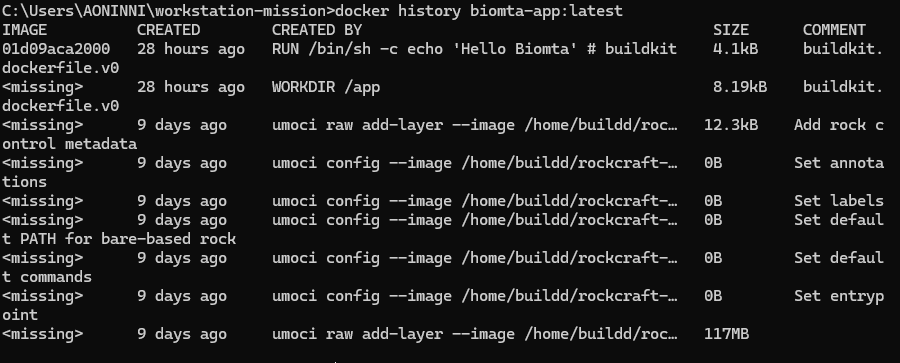

---

## 5. Nginx 웹 서버 실행 및 포트 매핑

호스트 PC의 8080 포트와 컨테이너의 80 포트를 연결합니다.

```bash
docker run -d -p 8080:80 --name web-test nginx
```

브라우저에서 다음 주소에 접속합니다.

```text
http://localhost:8080
```

정상적으로 실행되면 Nginx 기본 환영 페이지가 표시됩니다.

### Docker 웹 서버 실행 결과


실습 후 컨테이너를 정리하려면 다음 명령을 사용합니다.

```bash
docker rm -f web-test
```

---

## 6. 볼륨 마운트와 데이터 지속성

### 바인드 마운트(Bind Mount)

바인드 마운트는 호스트 PC의 특정 폴더를 컨테이너 내부 경로에 연결하는 방식입니다.

기존 실습에 기록된 명령:

```bash
docker run -d -v "$(pwd):/app" --name volume-test alpine sleep 3600
docker exec volume-test sh -c "mkdir -p /app && echo 'Hello Biomta Volume Persistence' > /app/persistence.txt"
docker rm -f volume-test
docker run -d -v "$(pwd):/app" --name volume-test-new alpine sleep 3600
docker exec volume-test-new cat /app/persistence.txt
```

기존 기록에 남아 있는 확인 문자열:

```text
Hello Biomta Volume Persistence
```

이 방식은 호스트 폴더에 파일이 저장되므로 컨테이너를 삭제하고 다시 만들어도 파일을 유지할 수 있습니다.

### Docker Named Volume 실습 (실제 실행 확인)

Named Volume은 Docker가 관리하는 저장 공간입니다. Windows CMD에서 아래 명령을 실제 실행했습니다.

```cmd
docker volume ls
docker run --rm -v my-volume:/data alpine sh -c "echo 'Docker Named Volume 실습 성공' > /data/test.txt"
docker run --rm -v my-volume:/data alpine cat /data/test.txt
```

Volume 목록에서 `my-volume`을 확인했고, 파일을 저장한 뒤 다시 읽었을 때 다음 결과가 출력되었습니다.

```text
Docker Named Volume 실습 성공
```

**실행 증거:** 2026-11-04 CMD 화면 캡처를 저장소에 업로드했습니다.


> `my_volume`도 Volume 목록에 있었지만, 이번 실습에서 실제 사용한 이름은 `my-volume`입니다.

---

## 7. Docker 이미지와 컨테이너의 차이

- **이미지(Image):** 컨테이너 실행에 필요한 파일과 설정을 담은 읽기 전용 템플릿입니다.
- **컨테이너(Container):** 이미지를 기반으로 실행되는 독립된 프로세스 환경입니다.

일반적인 작업 흐름:

1. `Dockerfile` 작성
2. `docker build`로 이미지 생성
3. `docker run`으로 컨테이너 실행
4. 소스나 설정 변경 시 이미지를 다시 빌드하고 새 컨테이너 실행

---

## 8. Docker 네트워크와 포트포워딩

컨테이너는 네트워크 네임스페이스 등을 통해 독립된 네트워크 환경을 사용할 수 있습니다.

`-p 8080:80` 옵션은 호스트의 8080 포트로 들어온 요청을 컨테이너의 80 포트로 전달합니다.

### 네트워크 확인 명령

```bash
docker network ls
docker network inspect bridge
```

### 사용자 정의 네트워크 실습 (실제 실행 확인)

Windows CMD에서 사용자 정의 네트워크를 만들고, Nginx 컨테이너와 테스트용 BusyBox 컨테이너를 같은 네트워크에 연결했습니다.

실행한 명령:

```cmd
docker network create biomta-net
docker network ls
docker run -d --name biomta-web --network biomta-net nginx
docker run --rm --network biomta-net busybox ping -c 3 biomta-web
```

BusyBox가 로컬에 없어 처음 실행할 때 Docker Hub에서 이미지를 내려받았으며, 이후 컨테이너 이름인 `biomta-web`을 대상으로 ping 테스트를 진행했습니다.

실제 확인 결과:

```text
PING biomta-web (172.18.0.2): 56 data bytes
64 bytes from 172.18.0.2: seq=0 ttl=64 time=0.674 ms
64 bytes from 172.18.0.2: seq=1 ttl=64 time=0.065 ms
64 bytes from 172.18.0.2: seq=2 ttl=64 time=0.075 ms

--- biomta-web ping statistics ---
3 packets transmitted, 3 packets received, 0% packet loss
```

**결과:** 3개 패킷을 보내 3개 모두 수신했고, 패킷 손실률은 0%였습니다. 같은 사용자 정의 네트워크에 연결된 컨테이너끼리 이름으로 통신할 수 있음을 확인했습니다.

### Docker 네트워크 실습 결과 캡처

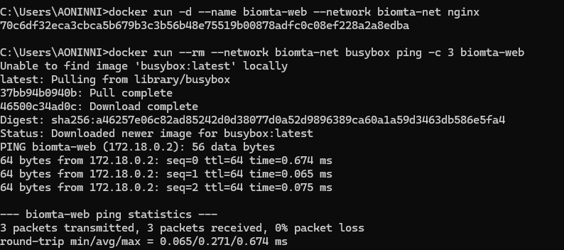


---

## 9. 경로(Path) 선택 기준

- 호스트 경로는 사용자 PC마다 다를 수 있으므로 Git Bash에서 `$(pwd)`와 같은 현재 경로 변수를 활용할 수 있습니다.
- 컨테이너 내부 경로는 `/app`처럼 명확한 절대 경로를 사용하는 것이 좋습니다.
- Windows와 Linux/macOS는 경로 표기 방식이 다를 수 있으므로 실행 환경에 맞는 명령을 사용해야 합니다.

---

## 10. 포트 충돌 진단 및 해결

이미 다른 프로그램이나 컨테이너가 포트를 사용 중이면 `port is already allocated` 또는 `Address already in use` 오류가 발생할 수 있습니다.

### 포트 사용 여부 확인

Windows CMD 또는 PowerShell:

```cmd
netstat -ano | findstr 8080
```

Git Bash에서 사용 가능한 경우:

```bash
netstat -ano | grep 8080
```

출력 마지막 열의 숫자는 PID(프로세스 ID)입니다. 해당 프로세스가 무엇인지 확인한 뒤 종료 여부를 결정합니다.

### 프로세스 확인 및 종료

Windows CMD 또는 PowerShell:

```cmd
tasklist /FI "PID eq 1234"
taskkill /PID 1234 /F
```

Linux/macOS:

```bash
ps -p 1234 -f
kill 1234
```

> `1234`는 명령 사용 방법을 보여주는 예시 PID입니다. 실제 출력에서 확인한 PID로 바꿔 사용해야 하며, 어떤 프로그램인지 확인하지 않고 프로세스를 종료하지 마세요.

---

## 11. Docker Volume과 Bind Mount 비교

| 구분 | Docker Volume | Bind Mount |
|---|---|---|
| 저장 위치 | Docker가 관리하는 저장 공간 | 사용자가 지정한 호스트 폴더 |
| 주요 용도 | 데이터베이스 등 지속 데이터 | 소스 코드 공유 및 개발 |
| 장점 | Docker가 수명과 저장 공간을 관리 | 호스트에서 파일을 바로 확인·수정 가능 |
| 고려 사항 | Docker 명령으로 관리하는 것이 편리 | 호스트 경로 및 권한에 영향을 받음 |

### Volume 백업 예시

```bash
docker volume create my_volume
docker run --rm -v my_volume:/volume -v "$(pwd):/backup" alpine tar -czf /backup/backup.tar -C /volume .
```

### Volume 복원 예시

```bash
docker volume create restored_volume
docker run --rm -v restored_volume:/volume -v "$(pwd):/backup" alpine tar -xzf /backup/backup.tar -C /volume
```

> 백업·복원 명령은 사용 예시입니다. 실제 백업 파일 생성 및 복원 여부는 별도로 실행해 확인해야 합니다.

---

## 12. 트러블슈팅 사례 기록

### Case 1. Docker 컨테이너 포트 충돌 및 해결 (실제 실행 확인)

**문제 현상**

Windows CMD에서 아래 명령으로 Nginx 컨테이너를 실행하려 했으나 실패했습니다.

```cmd
docker run -d -p 8080:80 --name port-test nginx
```

실제 오류 메시지:

```text
Bind for 0.0.0.0:8080 failed: port is already allocated
```

**원인 가설**

호스트 PC의 8080 포트를 이미 실행 중인 다른 Docker 컨테이너가 사용하고 있다고 판단했습니다.

**검증**

```cmd
docker ps
```

실행 중인 컨테이너 목록에서 다음 항목을 확인했습니다.

```text
biomta-container   0.0.0.0:8080->80/tcp
biomta-mount       0.0.0.0:8081->80/tcp
```

따라서 기존 `biomta-container`가 호스트의 8080 포트를 사용 중인 것이 원인이었습니다.

**조치**

1. 첫 번째 실행 시도에서 생성된 실습용 컨테이너 이름이 남아 있어 `docker rm port-test`로 해당 실습용 컨테이너만 삭제했습니다.
2. 기존 과제 컨테이너는 중지하거나 삭제하지 않았습니다.
3. 사용 중인 8080 대신 8082 포트로 변경해 다시 실행했습니다.

```cmd
docker rm port-test
docker run -d -p 8082:80 --name port-test nginx
docker ps
```

**해결 확인 결과**

두 번째 실행 명령은 컨테이너 ID를 반환했고, `docker ps`에서 다음 결과를 확인했습니다.

```text
fa26715decbc   nginx   Up   0.0.0.0:8082->80/tcp   port-test
```

**결론**

8080 포트를 사용 중인 기존 컨테이너와 포트가 겹쳐 발생한 오류였습니다. 호스트 포트를 8082로 변경하자 새 Nginx 컨테이너가 정상 실행되었습니다. 기존 `biomta-container`와 `biomta-mount`는 그대로 유지했습니다.

### Docker 포트 충돌 해결 결과 캡처

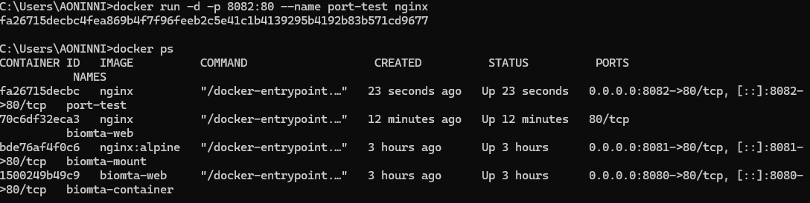

## 13. Ubuntu 컨테이너 실행 및 기본 명령어 실습

사용자 정의 이미지 `biomta-app:latest`를 실행해 Ubuntu 컨테이너 내부에 접속하고, 기본 Linux 명령어를 실습했습니다.

**실행 명령어**

```cmd
docker run --rm -it biomta-app:latest
```

**실습한 명령어 및 결과**

| 명령어 | 확인 내용 | 결과 |
|---|---|---|
| `pwd` | 현재 작업 폴더 확인 | `/app` |
| `ls -la` | 폴더 내 파일 목록 확인 | 정상 실행 |
| `echo "Hello Biomta Docker!" > test.txt` | 파일 생성 및 내용 저장 | 정상 실행 |
| `cat test.txt` | 파일 내용 확인 | `Hello Biomta Docker!` |

**결과:** Ubuntu 컨테이너에 접속하고 작업 폴더를 확인했으며, 컨테이너 내부에서 파일 생성과 내용 읽기가 정상적으로 수행됐습니다.

### Ubuntu 컨테이너 실습 결과 캡처

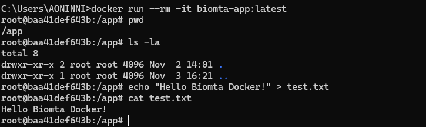

---


## 14. Docker 컨테이너 로그 확인 실습

실행 중인 Nginx 컨테이너 `biomta-container`의 로그를 확인했습니다.

**실행 명령어**

```cmd
docker logs biomta-container
```

**실제 확인 결과**
- Nginx 웹 서버가 정상적으로 시작된 기록을 확인했습니다.
- `Configuration complete; ready for start up` 메시지를 확인했습니다.
- `GET /` 요청이 HTTP 상태 코드 `200`으로 처리된 것을 확인했습니다.
- `favicon.ico` 요청은 파일이 없어 `404`가 기록됐지만, 웹 서버 실행 자체에는 문제가 없습니다.

### Docker 로그 확인 결과 캡처

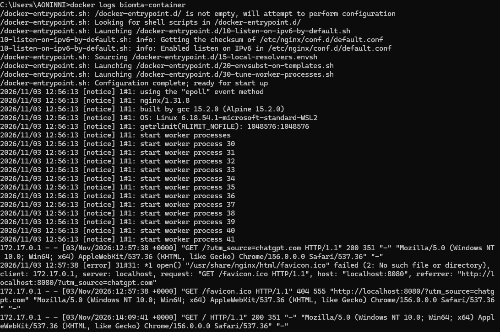

## 15. Docker 컨테이너 사용량 확인 실습

실행 중인 Docker 컨테이너들의 CPU, 메모리, 네트워크 및 디스크 입출력 사용량을 확인했습니다.

**실행 명령어**

```cmd
docker stats --no-stream
```

**실제 확인 결과**
- 실행 중인 컨테이너 5개의 사용량을 확인했습니다.
- CPU 사용률은 확인 시점에 모두 `0.00%`였습니다.
- 메모리 사용량은 약 `4.246MiB`부터 `13.4MiB`까지 표시됐습니다.
- 메모리 사용률은 약 `0.05%`부터 `0.17%`까지 표시됐습니다.

`--no-stream` 옵션을 사용해 사용량 정보를 한 번 출력하고 명령이 종료되는 것을 확인했습니다.

### Docker 사용량 확인 결과 캡처

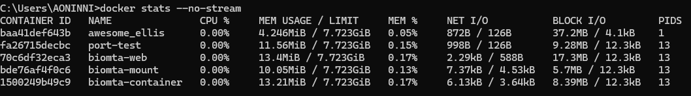

---

## 16. Docker Hello World 실행 실습

Docker가 정상적으로 설치되고 컨테이너를 실행할 수 있는지 확인했습니다.

**실행 명령어**

```cmd
docker run --rm hello-world
```

**실제 실행 결과**

```text
Hello from Docker!
This message shows that your installation appears to be working correctly.
```

Docker 클라이언트와 데몬의 통신, Docker Hub 이미지 다운로드, 컨테이너 생성 및 실행, 실행 결과 출력까지 정상적으로 완료됐습니다. `--rm` 옵션으로 실행이 끝난 컨테이너는 자동 삭제됩니다.

### Docker Hello World 실행 결과 캡처

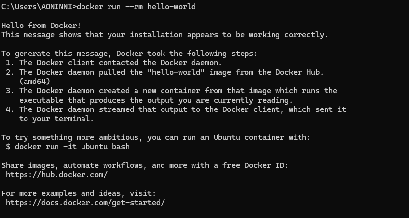

---

## 17. Docker exec 컨테이너 내부 명령어 실행 실습

실행 중인 Ubuntu 기반 컨테이너 `awesome_ellis` 내부에서 `docker exec` 명령어로 별도의 셸 접속 없이 명령어를 실행했습니다.

**실행한 명령어**

```cmd
docker exec awesome_ellis pwd
docker exec awesome_ellis ls -la /app
docker exec awesome_ellis cat /app/test.txt
```

**실제 확인 결과**

- 현재 작업 폴더: `/app`
- `/app` 폴더에서 `test.txt` 파일 확인
- 파일 내용: `Hello Biomta Docker!`

**결과:** 실행 중인 컨테이너에 `docker exec` 명령을 사용해 현재 경로, 파일 목록 및 파일 내용을 정상적으로 확인했습니다. 기존 컨테이너를 중지하거나 삭제하지 않고 실습했습니다.

### Docker exec 실습 결과 캡처

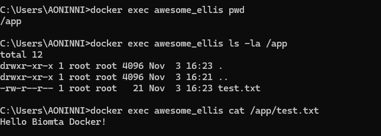

---

## 18. Docker 이미지 상세 정보 확인 실습

직접 만든 Docker 이미지 `biomta-app:latest`의 상세 설정을 확인했습니다.

**실행 명령어**

```cmd
docker image inspect biomta-app:latest
```

**실제 확인 결과**

- 이미지 이름: `biomta-app:latest`
- 운영체제: Linux
- 아키텍처: amd64
- 작업 디렉터리: `/app`
- 기본 실행 명령: `/bin/bash`
- 이미지 크기: 약 159MB

**결과:** `docker image inspect` 명령으로 직접 만든 이미지의 운영체제, 작업 디렉터리, 기본 실행 명령 및 크기를 확인했습니다.

### Docker 이미지 상세 정보 확인 결과 캡처

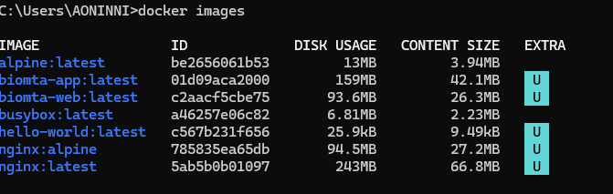

---

## 19. Docker 시스템 정보 확인 실습

Docker 엔진과 실행 환경의 상세 정보를 확인했습니다.

**실행 명령어**

```cmd
docker info
```

**실제 확인 결과**
- Docker Client/Server 버전: 29.9.2
- 실행 환경: Docker Desktop
- 운영체제: Linux
- 아키텍처: x86_64
- CPU: 12개
- 메모리: 약 7.723GiB
- 실행 중인 컨테이너: 5개

### Docker 시스템 정보 확인 결과 캡처

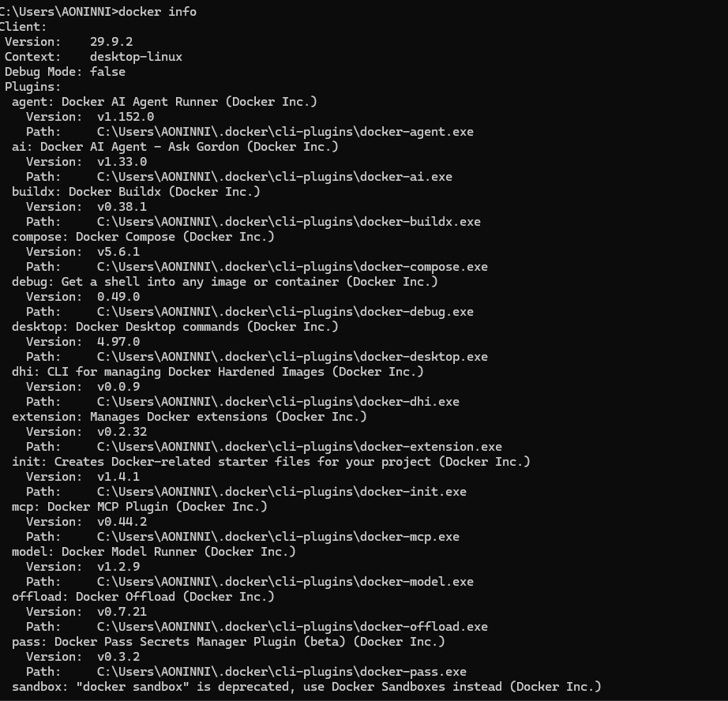

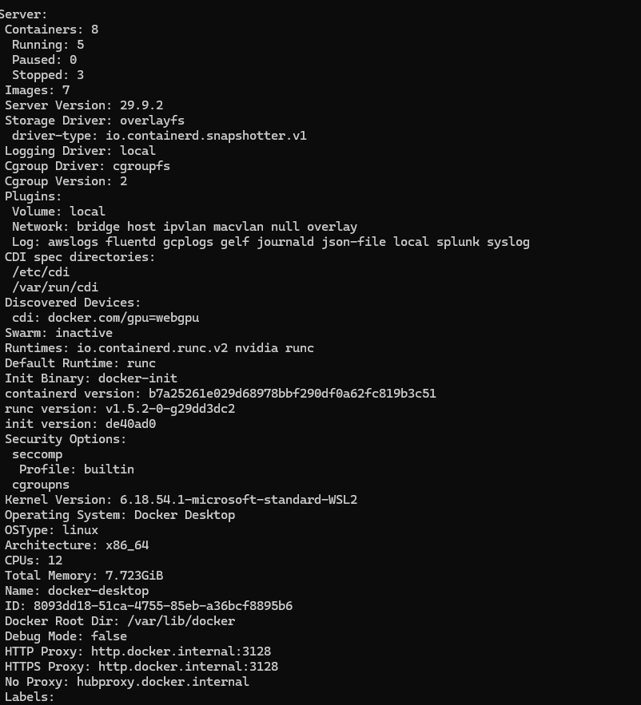

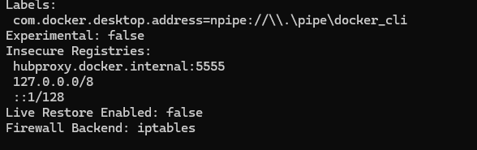

---

## 20. Docker 이미지 목록 확인 실습

로컬에 다운로드된 Docker 이미지 목록을 확인했습니다.

**실행 명령어**

```cmd
docker images
```

**실제 확인 결과**
- 이미지 7개 확인
- alpine, biomta-app, biomta-web, busybox, hello-world, nginx:alpine, nginx:latest

### Docker 이미지 목록 확인 결과 캡처

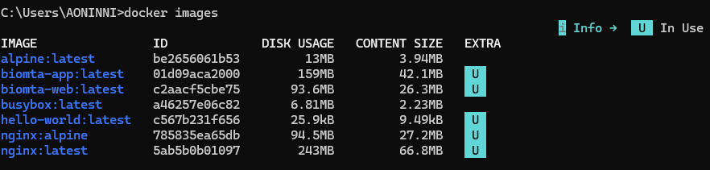

---

## 21. 실행 중인 Docker 컨테이너 목록 확인 실습

현재 실행 중인 컨테이너 목록을 확인했습니다.

**실행 명령어**

```cmd
docker ps
```

**실제 확인 결과**
- 실행 중인 컨테이너 5개 확인
- Ubuntu 기반 `awesome_ellis`와 Nginx 컨테이너 4개 확인
- 포트 매핑: 8080, 8081, 8082

### Docker 컨테이너 목록 확인 결과 캡처

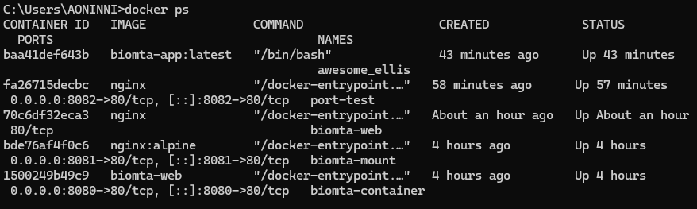

---

## 22. 전체 Docker 컨테이너 목록 확인 실습

실행 중인 컨테이너와 종료된 컨테이너를 모두 확인했습니다.

**실행 명령어**

```cmd
docker ps -a
```

**실제 확인 결과**
- 전체 컨테이너 8개 확인
- 실행 중인 컨테이너 5개
- 종료된 컨테이너 3개
- 기존 컨테이너는 삭제하지 않고 상태만 확인했습니다.

### 전체 Docker 컨테이너 목록 확인 결과 캡처

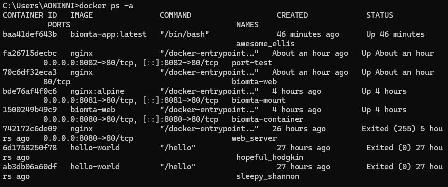

---

## 23. Git 버전 확인 실습

Windows CMD에서 Git 버전을 확인했습니다.

**실행 명령어**

```cmd
git --version
```

**실제 확인 결과**

```text
git version 2.56.0.windows.4
```

### Git 버전 확인 결과 캡처

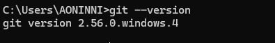

---

## 24. 제출 전 최종 확인

- [x] README의 제목과 실습 설명 확인
- [x] Dockerfile, script.sh, test.txt 등 필요한 파일 확인
- [x] `05_docker_web_server.png`가 저장소에 존재하는지 확인
- [x] GitHub README 화면에서 이미지가 정상 표시되는지 확인
- [x] Named Volume 실습 결과 캡처 업로드 및 README 연결
- [x] Docker 네트워크 실습 결과 캡처 업로드 및 README 연결
- [x] 트러블슈팅 실제 검증 및 조치 결과 README에 기록
- [x] 트러블슈팅 오류 및 해결 과정 화면 캡처 업로드 및 README 연결
- [x] Ubuntu 컨테이너 실행 및 기본 명령어 실습 결과 캡처 업로드 및 README 연결
- [x] Docker 컨테이너 로그 확인 결과 캡처 업로드 및 README 연결
- [x] Docker 컨테이너 사용량 확인 결과 캡처 업로드 및 README 연결
- [x] Docker Hello World 실행 결과 캡처 업로드 및 README 연결
- [x] Docker exec 컨테이너 내부 명령어 실행 결과 캡처 업로드 및 README 연결
- [x] Docker 이미지 상세 정보 확인 결과 캡처 업로드 및 README 연결
- [x] Docker 시스템 정보 확인 결과 캡처 업로드 및 README 연결
- [x] Docker 이미지 목록 확인 결과 캡처 업로드 및 README 연결
- [x] 실행 중인 Docker 컨테이너 목록 캡처 업로드 및 README 연결
- [x] 전체 Docker 컨테이너 목록 캡처 업로드 및 README 연결

